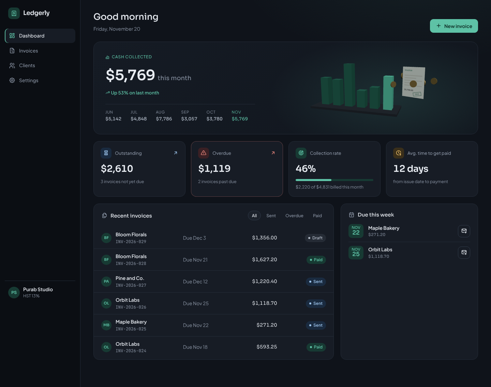
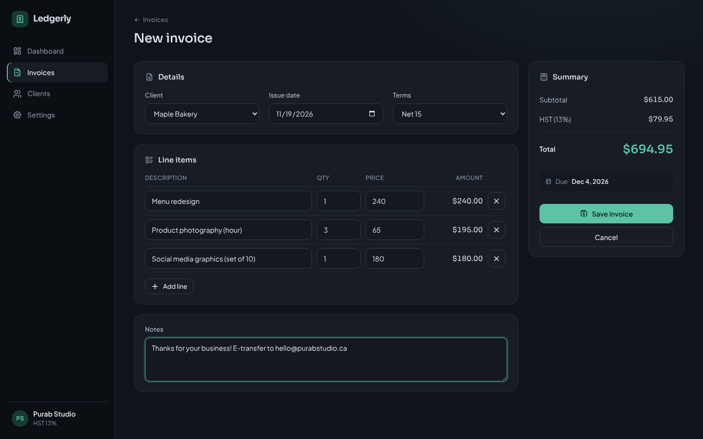
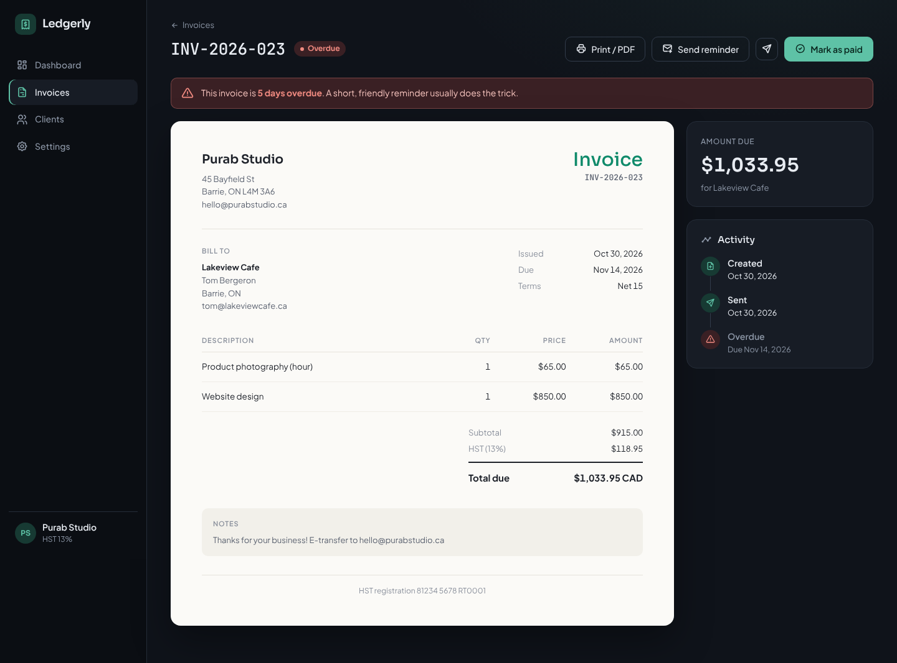
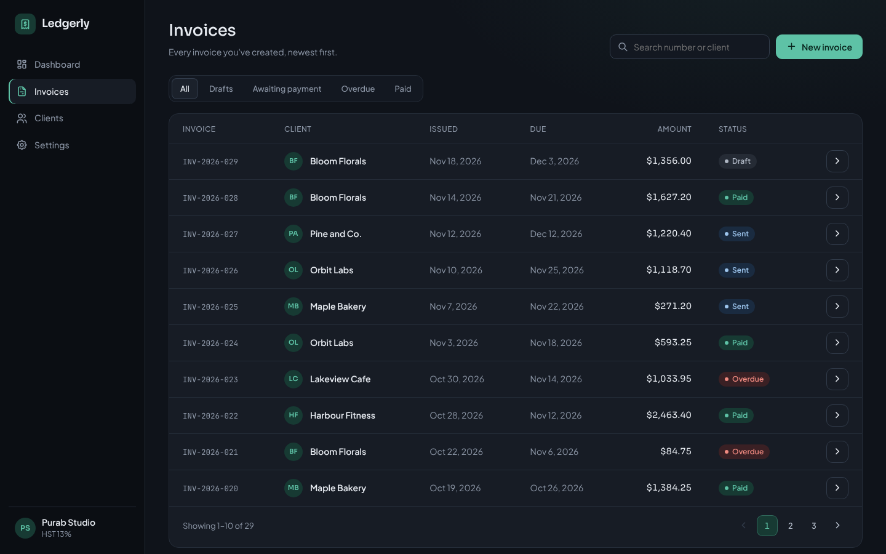
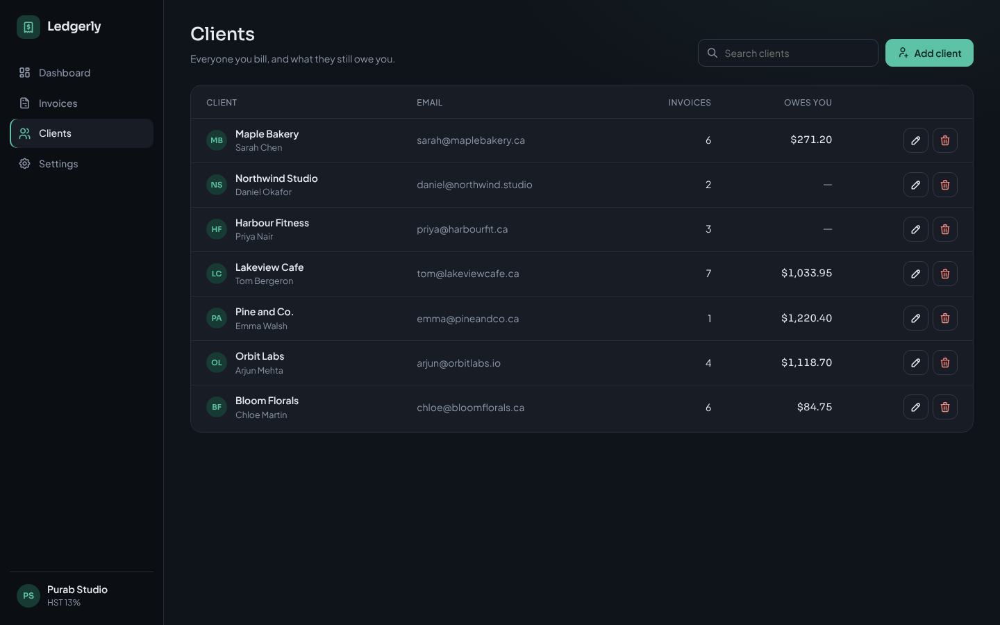

# Ledgerly

A clean, dark-themed invoice manager for freelancers and small businesses. Create professional invoices with HST worked out for you, print them as PDFs, and see at a glance who has paid, who hasn't, and who's late.



## Description

Ledgerly is a Django web app backed by Microsoft SQL Server. You add your business details once, keep a list of clients, and build invoices line by line while the subtotal, HST and total update as you type. Invoices are emailed straight to the client, and each one moves through **Draft → Sent → Paid**, and the app marks an invoice **Overdue** on its own once the due date passes. The dashboard turns all of that into numbers you can act on: money collected this month, money still out, what's overdue, how fast clients usually pay, and what's due this week.

## Purpose

I'm in an entrepreneurial co-op program, and one thing every small business has to do is bill people and then actually get paid. Most freelancers I know make invoices in Word or Excel, work out the tax by hand, and lose track of who still owes them. I wanted to build something I'd actually use: quick to make an invoice, impossible to get the tax wrong, and honest about which payments are late.

**Who it's for:** freelancers, tutors, designers, photographers, and small shops that send a handful of invoices a month.

## Features

- **Dashboard** where every number appears once: a 3D animated cash flow scene (three.js) with this month's total, the trend and the last six months; cards for outstanding, overdue, collection rate and average days to get paid; recent invoices with a status filter; and a "due this week" list
- **Invoice builder** with line items you can add and remove, live subtotal / HST / total, and a due date worked out from the payment terms
- **Automatic invoice numbers** (`INV-2026-001`, `INV-2026-002`, ...) that restart each year and can never repeat
- **Status flow**: Draft → Sent → Paid, with Overdue worked out from the due date (never stored, so it can't go stale)
- **Invoice page** laid out like a real sheet of paper, with an activity timeline
- **Send invoices by email**: one click emails the client a branded message with the invoice **attached as a PDF** and marks it as sent. If the email fails (wrong password, no internet) the invoice stays a draft and you're told why. Sent invoices can be resent
- **Print / Save as PDF** from the browser, using a print-only stylesheet that hides everything except the invoice
- **Payment reminders**: one click (on the invoice page or from "Due this week" on the dashboard) emails a polite, professional reminder with the invoice PDF attached. The wording changes depending on whether it's due soon or already overdue, and it says how many days late it is
- **Invoices list** with status tabs and pagination, search across every invoice, and 10 rows per page. Changing the page, tab or search only swaps the table (a `fetch` request returns just that part), so the rest of the page doesn't reload, and the back button still works
- **Clients** with live search, add/edit in a pop-up, and how much each one owes
- **Settings** for business details, HST number, tax rate, and an "HST off" switch for small suppliers
- **Validation** in the browser and on the server: no empty invoices, no negative quantities, tax rate capped at 100%
- **Safe deletes**: sent invoices are kept for your records, and clients with invoices can't be deleted
- **Demo data** command so the dashboard can be filled in seconds
- **23 automated tests** for the money maths, numbering, statuses, emails and PDF attachments, pagination and the main pages

## Technologies

| Area | Tools |
|---|---|
| Backend | Python 3.12+, Django 5.2 (LTS) |
| Database | Microsoft SQL Server via `mssql-django` and `pyodbc` (SQLite fallback for quick testing) |
| Frontend | Django templates, vanilla JavaScript, hand-written CSS |
| 3D animation | three.js (loaded from a CDN as an ES module) |
| Fonts and icons | Plus Jakarta Sans, Sora, JetBrains Mono (Google Fonts), Tabler Icons |
| Email | Django's email framework over SMTP (works with a Gmail App Password) |
| PDF | ReportLab, to build the invoice PDF attached to emails |
| Config | `python-dotenv` for the `.env` file |
| Tools | VS Code, Git and GitHub, SQL Server Management Studio |

## AI Tools Used

- **Claude** (Anthropic): brainstorming the idea, design previews, generating code, debugging, testing, and drafting documentation

The full conversation, prompt by prompt, is in [PROMPT.md](PROMPT.md).

## Installation

You'll need **Python 3.12+**, **SQL Server** (Express or Developer is fine) and the **ODBC Driver 17 or 18 for SQL Server**.

1. Clone the repository

   ```powershell
   git clone https://github.com/PurabPriyani/VibeCodingProject.git
   cd VibeCodingProject
   ```

2. Create a virtual environment and install the packages

   ```powershell
   python -m venv venv
   venv\Scripts\activate
   pip install -r requirements.txt
   ```

3. Create the database. In SQL Server Management Studio, open a new query and run:

   ```sql
   CREATE DATABASE ledgerly;
   ```

4. Copy the example settings and fill them in

   ```powershell
   copy .env.example .env
   ```

   | Setting | What to put |
   |---|---|
   | `DB_HOST` | Your server name from SSMS, e.g. `localhost` or `localhost\SQLEXPRESS` |
   | `DB_DRIVER` | `ODBC Driver 17 for SQL Server` or `ODBC Driver 18 for SQL Server` |
   | `DB_USER` / `DB_PASSWORD` | Leave empty to use Windows Authentication |

   Not sure which driver you have? Run this in PowerShell:

   ```powershell
   Get-OdbcDriver | Where-Object Name -like "*SQL Server*" | Select-Object Name
   ```

   **No SQL Server?** Set `DB_ENGINE=sqlite` in `.env` and the app runs on a local file instead.

5. Create the tables

   ```powershell
   python manage.py migrate
   ```

6. (Optional) Set up email so "Send invoice" really emails the client. Without this, emails are printed in the terminal instead, which is fine for testing.

   For Gmail, turn on 2-Step Verification, create an App Password at https://myaccount.google.com/apppasswords, and add this to `.env`:

   ```dotenv
   EMAIL_HOST=smtp.gmail.com
   EMAIL_PORT=587
   EMAIL_USE_TLS=True
   EMAIL_HOST_USER=you@gmail.com
   EMAIL_HOST_PASSWORD=your16letterapppassword
   DEFAULT_FROM_EMAIL=Your Business <you@gmail.com>
   ```

## Running the Application

```powershell
python manage.py runserver
```

Open http://127.0.0.1:8000.

To fill the app with sample clients and invoices for a demo:

```powershell
python manage.py seed_demo          # only runs on an empty database
python manage.py seed_demo --reset  # clears clients and invoices first
```

To run the tests:

```powershell
python manage.py test invoices
```

## Project Structure

```
config/              Django settings and root URLs
invoices/
  calculations.py    All money maths (rounding, subtotal, tax, total)
  models.py          BusinessProfile, Client, Invoice, InvoiceItem
  forms.py           Forms and the line-item formset
  emails.py          Sends invoice and reminder emails
  pdf.py             Builds the invoice PDF for attachments
  views.py           Pages and actions
  templatetags/      The |cad filter for formatting dollars
  management/        seed_demo command
  tests.py           Automated tests
templates/           Page templates (and emails/ for the invoice email)
static/css/app.css   The whole theme
static/js/           Page scripts (invoice builder, dashboard, clients, 3D hero)
docs/screenshots/    Screenshots used in this README
```

## How AI Was Used

I used Claude through the whole project, not just to write code. It helped me brainstorm and narrow down the idea, mocked up three dashboard designs to choose from, planned the build into commit-sized stages, wrote the code for each stage, and helped me test and fix the problems we found. I picked the idea, the design, the stack and the scope, ran every stage on my own machine, and committed each one after it worked.

### Three prompts that shaped the app

**1. Turning a vague idea into a real spec**

> I have only 2 hrs. Concise the project accordingly. Keep the necessary features for this assignment which can get me full marks. Use sql server and django for the backend. And vanilla JS for frontend. Whatever code you generate should be optimized and precise. [...] I want you to give me a few designs and overview of the application first. What pages it would have and what features to keep? The features should be of intermediate level.

This set the stack, the time limit and the level of the features, and asked for designs before any code. That gave me five clear pages and a commit plan.

**2. Pushing the design further**

> give me some more preview designs, these are very basic designs, add some related icons in the application. Think like an expert and experienced UI / UX designer and also make use of three.js connector to come up with some animations for the dashboard

The first mockups were too plain. This prompt led to the icon set, the KPI cards, the collection ring, the "due this week" list and the 3D cash flow scene.

**3. Locking in the final look**

> I am using microsoft SQL server 20 and it is already installed. Design will be B. Make sure to use better fonts, this looks very basic

This picked the dark "Midnight ledger" theme and replaced the default fonts with Plus Jakarta Sans for text, Sora for numbers and headings, and JetBrains Mono for invoice numbers.

## Screenshots

**Dashboard** with the 3D cash flow scene, six-month summary and KPI cards


**Invoice builder** with live totals


**Overdue invoice** with the reminder button and activity timeline


**Invoices list** with status tabs and pagination


**Clients** with search and balances


## Future Improvements

1. **Online payments**: a "Pay now" link on each invoice (Stripe or Interac) that marks the invoice paid automatically
2. **Automatic reminders**: send reminder emails on a schedule (for example 3 days before and 7 days after the due date) instead of clicking a button
3. **Recurring invoices** for monthly clients like retainers or maintenance plans
4. **User accounts** so several businesses can use the same installation, each seeing only their own data
5. **Discounts, deposits and partial payments**
6. **CSV export** for an accountant, plus a simple yearly HST summary for tax time
7. **French invoices** for Quebec and bilingual clients

## Vibe Coding Reflection

> These are my notes from building the project. I've written them from what actually happened during development.

### 1. What did AI do particularly well?

It saved the most time on the parts that are fiddly but well known. The invoice builder is a good example: a Django inline formset with rows you can add and remove in JavaScript, a hidden DELETE checkbox per row, and totals that update as you type. Getting the formset prefixes and the `TOTAL_FORMS` counter right by hand would have taken me a long time, and Claude got it working on the first try. It was also very quick at visual work: it mocked up three complete dashboard designs before writing any code, so I could choose a direction in minutes.

### 2. What did AI do poorly?

- **Rounding mismatch.** The first version of the live total in JavaScript used `Math.round(value * 100) / 100`. For a line like 0.5 × $2.01 the browser showed **$1.00** while the saved invoice said **$1.01**, because 1.005 × 100 is really 100.4999... in floating point. The fix was to round with exponent notation, so the preview matches the server.
- **Inconsistent money formatting.** Using Django's `intcomma` with the `en-ca` locale showed **$5 769** on the dashboard but **$1,356.00** in tables. I replaced it with one custom `cad` filter so every amount looks the same, and added a test for it.
- **Layout bugs** that only showed up when I looked at the pages: table headers that should have been right-aligned weren't (a CSS specificity problem), toast messages covered the "New invoice" button, and the sidebar stopped halfway down long pages.
- **The 3D scene took several tries.** The first camera was too far away and the scene looked tiny, and the next one was so close the invoice card was cut off.
- **Two dashboard numbers overlapped.** The Outstanding card counted every unpaid invoice, including overdue ones, so it said "4 invoices awaiting payment" while the Invoices page's "Awaiting payment" tab listed 3 and the Overdue card counted the fourth. I noticed the mismatch while testing a fresh clone. Now an invoice counts as outstanding until its due date and as overdue after it, and a test checks the two never overlap.
- **The first dashboard repeated itself.** After adding the 3D hero, the same numbers showed up two or three times: "collected this month" was in the hero and a card, the overdue count was in the header, the hero and a card, and the 3D bars showed the same six months as the 2D bar chart. I noticed it while testing and asked for it to be fixed. Now each number has one home, and the 2D chart was replaced by a labelled month strip under the 3D bars.
- **Early ideas were generic.** My first few requests got typical suggestions (to-do lists, quiz apps), and I had to push back several times before landing on something useful.
- **Library versions.** The newest `mssql-django` (2.0) switched to a different database driver, so we checked the package metadata and pinned Django 5.2 LTS with `mssql-django` 1.8, which still uses the standard `pyodbc` driver.

### 3. How did I verify AI-generated code?

- Ran every stage on my own machine against SQL Server before committing it
- Tried to break the forms on purpose: empty invoices, negative quantities, a 150% tax rate, deleting a client who has invoices, editing an invoice that was already sent
- Checked the money maths with awkward numbers (3 × $19.99 + $250 at 13% should be exactly $350.27)
- Compared the live total in the browser with the total saved in the database, which is how the rounding bug was found
- Added 23 automated tests (`python manage.py test invoices`) covering rounding, tax, numbering, due dates, overdue status, the status flow, and every page loading
- Looked at screenshots of every page, which is how the formatting and layout bugs were found

### 4. How did my prompts evolve?

My first prompt was very open: *"come up with good and unique ideas for this assignment."* The results were broad and not what I wanted, so I narrowed it down step by step: first "useful in everyday life," then "not games," then a specific area. Once I chose the invoice idea, my prompts became much more specific: a 2-hour limit, Django + SQL Server + vanilla JS, intermediate-level features, designs before code, and at least five commits. The later prompts were short and targeted ("design B, better fonts"), because by then the AI and I had a shared picture of the app. The biggest lesson was that saying what I *don't* want is as useful as saying what I do.

### 5. What did I learn?

- **Never use floats for money.** I knew this in theory, but seeing a one-cent difference between the browser and the database made it real. The app uses Python's `Decimal` with `ROUND_HALF_UP` everywhere.
- **Store what doesn't change, calculate what does.** Totals are saved on the invoice (fast dashboard, and an old invoice doesn't change if the tax rate changes later), but "overdue" is worked out every time from the due date so it's never out of date.
- **Small commits make AI-assisted work much safer.** Building in stages and running each one before moving on meant every bug was easy to trace.
- **Prompting is a design skill.** Clear constraints (time, stack, level, look) got far better results than asking for something "good."

### 6. Would I trust AI to build the entire application without human supervision?

No. Claude wrote most of the code quickly and most of it worked, but every real bug in this project (the one-cent rounding difference, the mixed number formats, the hidden button) was only found because a person ran the app, tried odd inputs and looked at the screens. An invoice app handles people's money and tax, so "mostly right" isn't good enough. AI is a very fast teammate, but someone has to decide what to build, check the results, and take responsibility for them, and that was my job.
